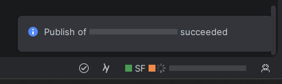
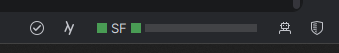
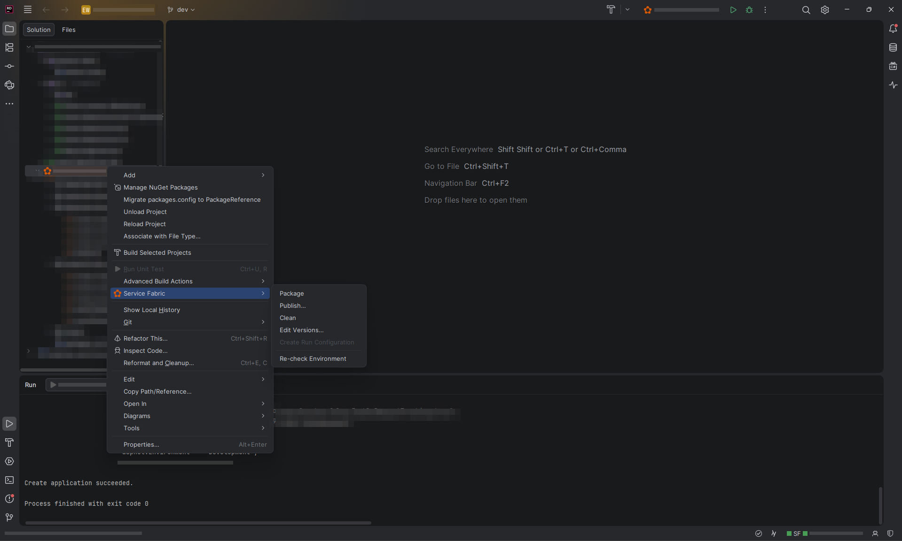

<div align="center">

# Azure Service Fabric for Rider

**Package, publish, debug and monitor your Service Fabric applications without leaving JetBrains Rider.**

[](https://github.com/LoloActemium/rider-servicefabric/releases/latest)



&nbsp;&nbsp;


</div>

---

Visual Studio has always shipped first-class tooling for Azure Service Fabric. Rider did not.
This plugin brings the everyday Service Fabric workflow to Rider: right-click your `.sfproj`, publish to your
local cluster, hit **Debug** and land on your breakpoints in every service.



## ✨ Features

| | |
|---|---|
| 📦 **Package** | `Service Fabric > Package` builds the application package with the right configuration and platform, with a live console and cancellation. |
| 🚀 **Publish** | Publish dialog with profiles, upgrade / overwrite options and parameters; runs `Deploy-FabricApplication.ps1` for you. |
| 🐞 **Run & Debug** | A *Service Fabric Application* run configuration (auto-created). **Debug** deploys, then attaches the .NET debugger to **every** service process — actors, stateless and stateful services. |
| 🔒 **Safe while debugging** | Run/Debug are disabled during a debug session; Publish and Clean warn you and stop the sessions first. |
| 🧹 **Clean** | `Service Fabric > Clean` removes the application and its type from the local cluster, runs MSBuild Clean and deletes `pkg`. Rider's own *Build > Clean* removes the application from the local cluster too, like Visual Studio. |
| 🏷️ **Edit Versions** | Edit application, service and package versions in one dialog, with automatic roll-up — a single undo restores everything. |
| 🧠 **Manifest IntelliSense** | Completion and validation in `ApplicationManifest.xml`, `ServiceManifest.xml`, `Settings.xml` and parameter files, from the SDK schemas. |
| 🚦 **Live cluster health** | Status bar widget with the local cluster state and each application's health — same colors as Service Fabric Explorer, an orange *starting* state, and a notification when your app is really ready. |
| 🩺 **Environment check** | Detects the SDK, the PowerShell module and the local cluster, and tells you what is missing. |

## 📥 Installation

1. In Rider: **Settings › Plugins › ⚙ › Manage Plugin Repositories…** and add
   ```
   https://github.com/LoloActemium/rider-servicefabric/releases/latest/download/updatePlugins.xml
   ```
2. Open the **Marketplace** tab, search **Azure Service Fabric**, install and restart Rider.

That's it — Rider will offer new versions automatically.

> Prefer a one-off install? Download the zip from the
> [latest release](https://github.com/LoloActemium/rider-servicefabric/releases/latest) and use
> **Settings › Plugins › ⚙ › Install Plugin from Disk…** (no automatic updates in that case).

### Requirements

- Windows with the **Azure Service Fabric SDK** and a local development cluster
- **JetBrains Rider 2026.3** (build 263.x)
- To debug services on the local cluster, **run Rider as administrator** (same as Visual Studio)

## 🎯 Getting started

1. Open a solution containing a Service Fabric application project (`.sfproj`).
2. Right-click the project › **Service Fabric** (right after *Advanced Build Actions*).
3. Pick **Publish…**, or use the auto-created run configuration and press **Debug**.
4. Watch the status bar: orange while the services start, green when the application is ready.

Settings live under **Settings › Tools › Service Fabric** (PowerShell execution policy, auto-created run
configurations, Rider Clean behavior, health polling interval, "ready" stability and startup grace period).

## 🛠️ Development

The plugin is a frontend-only Kotlin plugin built with Gradle and the IntelliJ Platform Gradle Plugin.
It compiles against the local Rider install (`%LOCALAPPDATA%\Programs\Rider`, override with `-PriderPath=<path>`)
and uses Rider's bundled JBR as JDK.

```powershell
$jbr = "-Porg.gradle.java.installations.paths=$env:LOCALAPPDATA\Programs\Rider\jbr"

.\gradlew.bat test buildPlugin verifyPluginStructure $jbr   # build + tests -> build\distributions
.\gradlew.bat runIde $jbr                                   # sandboxed Rider with the plugin
```

### Releasing

Releases are published to **GitHub Releases** from a developer machine (requires the GitHub CLI, `gh auth login`).

```powershell
.\gradlew.bat bumpVersion                                   # 0.1.15 -> 0.1.16, removes old zips
.\gradlew.bat test buildPlugin verifyPluginStructure $jbr
git commit -am "chore: release 0.1.16"; git push
.\gradlew.bat githubRelease $jbr                            # release v0.1.16 with the zip + updatePlugins.xml
```

`updatePlugins.xml` points to `<pluginRepositoryUrl>/<zip>`; `{version}` in `pluginRepositoryUrl`
(`gradle.properties`) is replaced by the plugin version. A folder-based repository is also supported:
`.\gradlew.bat publishToRepository -PpluginRepositoryDir=<folder> -PpluginRepositoryUrl=`.

The detailed specification is in [`SPEC.md`](SPEC.md).
